# 一次完整同步周期（业务流程图）

> 图例：绿色 ✅ = 已实现；黄色虚线 ⬜ = 未实现；蓝色 = 调用外部工具；红色 = 安全闸门。
> 更新于 2026-10-28，对应提交 `62b8992`。

## 主流程

```mermaid
flowchart TD
    START(["开始：一次同步周期"])

    subgraph S0["① 前置检查"]
        direction TB
        A1["定位 master.db<br/>盘符会变，用 --db 指定"]
        A2["doctor 体检（只读副本）"]
        A3{"Rekordbox 在运行？"}
        A1 --> A2 --> A3
    end
    START --> A1
    A3 -- "是（读库不受影响，写库会拒绝）" --> A4["提醒：进入写库阶段前必须关闭"]
    A4 -.-> A3

    subgraph S1["② 读歌单 · plan ✅"]
        direction TB
        B1["歌单链接 / 纯 ID / 本地 CSV"]
        B2["识别平台 → playlist_id"]
        B3["拉有序成员 ID → content_hash"]
        B4{"与上次快照一致？"}
        B5["复用元数据（0 次请求）"]
        B6["diff：新增 / 移除 / 重排 / 改名 / 变灰"]
        B7["只为新增曲目拉元数据"]
    end
    A3 -- "否" --> B1
    B1 --> B2 --> B3 --> B4
    B4 -- "是" --> B5
    B4 -- "否" --> B6 --> B7

    B8["state/selection.json<br/>+ state/playlists/*.json"]
    B5 --> B8
    B7 --> B8

    B8 --> C0{"本次有新增曲目？"}
    C0 -- "否" --> Z1(["结束：只更新快照，无事可做"])

    subgraph S2["③ 曲目解析：这首歌本地有没有"]
        direction TB
        C1["三层匹配：路径 → 曲名+主艺人 → 时长容差"]
        C2{"命中？"}
        C3["已有 → 复用"]
        C4["缺失 → 待下载"]
        C5["多命中 → 歧义队列"]
        C1 --> C2
        C2 -- "唯一" --> C3
        C2 -- "无" --> C4
        C2 -- "多个" --> C5
    end
    C0 -- "是" --> C1

    subgraph S3["④ 获取音频 · fetch ⬜"]
        direction TB
        D1["按待下载清单调用外部下载器"]
        D2{"拿到的是 .ncm？"}
        D3["提示：由你自行解密<br/>（仓库不内置、不调用）"]
        D4["落盘到移动硬盘指定目录"]
        D1 --> D2
        D2 -- "是" --> D3 --> D4
        D2 -- "否" --> D4
    end
    C4 --> D1

    subgraph S4["⑤ 转换 · convert ⬜"]
        E0["外部工具转成 Rekordbox 可读格式<br/>mp3 / wav / aiff / flac / m4a"]
    end
    D4 --> E0

    subgraph S5["⑥ 归属映射 · mapping ⬜"]
        direction TB
        F1["由歌单快照推导 track → [playlist…]"]
        F2["多对多：一首歌可进多个 playlist"]
        F3["增量状态：同步过的记下来，下次跳过"]
        F1 --> F2 --> F3
    end
    E0 --> F1
    C3 --> F1

    subgraph S6["⑦ collection 对齐（最容易漏的一步）"]
        direction TB
        G1["扫描磁盘 → 与 djmdContent 匹配"]
        G2{"已在 collection？"}
        G3["取 content_id"]
        G4["先导入 collection"]
        G1 --> G2
        G2 -- "是" --> G3
        G2 -- "否" --> G4 --> G3
    end
    F3 --> G1

    subgraph S7["⑧ 写入计划 · write --dry-run ⬜"]
        direction TB
        H1["读库副本：playlist 是否存在<br/>（名称 casefold 匹配，多处同名要报错）"]
        H2["算 diff：要建 / 要加 / 已存在跳过"]
        H3["write_plan.json + 人可读预览"]
        H1 --> H2 --> H3
    end
    G3 --> H1
    H3 --> I0{"你确认这份计划？"}
    I0 -- "否" --> Z2(["结束：计划存档，库未动"])

    subgraph S8["⑨ 安全写入 · write ⬜"]
        direction TB
        J1{"Rekordbox 进程？"}
        J2["拒绝写入"]
        J3["备份 master.db + masterPlaylists6.xml"]
        J4["存在取 ID / 不存在创建<br/>（Attribute=0 是歌单，1 是文件夹）"]
        J5["插入 djmdSongPlaylist<br/>按源顺序写 TrackNo，已存在跳过"]
        J6["commit（USN 自增）"]
        J7["integrity_check + 重读校验"]
        J8["从备份还原"]
        J1 -- "在运行" --> J2
        J1 -- "未运行" --> J3 --> J4 --> J5 --> J6 --> J7
        J7 -- "不通过" --> J8
    end
    I0 -- "是" --> J1

    subgraph S9["⑩ 对账收尾"]
        direction TB
        K1["重开 Rekordbox 人工确认"]
        K2["更新增量状态 + 生成本次报告"]
        K1 --> K2
    end
    J7 -- "通过" --> K1
    K2 --> Z3(["结束：一个周期完成"])

    subgraph SR["维护支线：盘符变了 / 路径失效"]
        direction TB
        R1["doctor 报大量缺失"]
        R2["relink 算映射<br/>root_remap / basename / basename_ext"]
        R3["人工核对 relink_plan.json"]
        R4["relink --apply 回写路径 ⬜"]
        R1 --> R2 --> R3 --> R4
    end
    A2 -.-> R1
    R4 -.-> G1

    classDef done fill:#d1e7dd,stroke:#0f5132,color:#0f5132
    classDef todo fill:#fff3cd,stroke:#997404,color:#664d03,stroke-dasharray:5 3
    classDef ext fill:#cfe2ff,stroke:#084298,color:#084298
    classDef gate fill:#f8d7da,stroke:#842029,color:#842029

    class B1,B2,B3,B4,B5,B6,B7,B8 done
    class A2,R1,R2,R3 done
    class C1,C3,C5 todo
    class D1,D4,E0 ext
    class F1,F2,F3,G1,G3,G4,H1,H2,H3,J3,J4,J5,J6,J7,J8,K1,K2 todo
    class A3,J1,I0 gate
    class C4,D2 todo
```



## 纯文本版（不方便渲染时看这个）

```
[0] 前置     定位 master.db（F:\PIONEER\Master\master.db，盘符会变）
             └ doctor 体检（只读副本）→ 看 RB 是否在运行
                        ↓
[1] 读歌单   链接/ID/CSV → 识别平台 → 有序成员 ID → content_hash
    plan ✅   ├ 与上次快照一致 → 复用，0 次元数据请求
             └ 有变化 → diff 新增/移除/重排 → 只拉新增曲目元数据
                        → state/selection.json + playlists/*.json
                        ↓
[2] 曲目解析 三层匹配：路径 → 曲名+主艺人 → 时长容差
             ├ 唯一命中 → 已有，复用
             ├ 没命中   → 待下载
             └ 多命中   → 歧义，交人工（不猜）
                        ↓
[3] 获取音频 调用外部下载工具（musync / TuneScout / yun …）
    fetch ⬜  └ 拿到 .ncm → 提示你自己解密（仓库不内置）
                        ↓
[4] 转换     外部工具 → Rekordbox 可读格式
    convert ⬜        ↓
[5] 归属映射 歌单快照 → track → [playlist…]（多对多）
    mapping ⬜ + 增量状态：同步过的记下来，下次跳过
                        ↓
[6] collection 对齐   文件 ≠ 曲目！匹配 djmdContent，没入库的先 import
                        ↓
[7] 写入计划 读副本 → playlist 是否存在 / 已有哪些成员 → 算 diff
    write --dry-run ⬜  → write_plan.json → ★你确认
                        ↓
[8] 安全写入 RB 已关闭 → 备份 → 存在取 ID / 不存在创建 → 插成员
    write ⬜  → commit（USN 自增）→ integrity_check → 失败则回滚
                        ↓
[9] 对账收尾 重开 RB 人工确认 → 更新增量状态 → 生成报告
```

## 十个步骤的输入/输出

| # | 阶段 | 输入 | 输出 | 命令 | 状态 |
|---|---|---|---|---|---|
| 0 | 前置检查 | 库路径 | 库可用性、RB 进程状态 | `doctor` | ✅ |
| 1 | 读歌单 | 链接 / ID / CSV | `selection.json` + 歌单快照 | `plan` | ✅ |
| 2 | 曲目解析 | 快照 + 磁盘文件 | 已有 / 待下载 / 歧义 三分类 | （未接 CLI） | ⬜ |
| 3 | 获取音频 | 待下载清单 | 音频文件 | `fetch` | ⬜ |
| 4 | 转换 | 原始音频 | Rekordbox 可读格式 | `convert` | ⬜ |
| 5 | 归属映射 | 快照 + 曲目身份 | `track → [playlist]` | `mapping` | ⬜ |
| 6 | collection 对齐 | 磁盘文件 + 库 | `content_id` 对应表 | （未接 CLI） | ⬜ |
| 7 | 写入计划 | 归属表 + 库现状 | `write_plan.json` | `write --dry-run` | ⬜ |
| 8 | 安全写入 | 写入计划 + 备份 | 新 playlist 与成员 | `write` | ⬜ |
| 9 | 对账收尾 | 写入报告 | 增量状态、报告 | （未接 CLI） | ⬜ |

## 三个"顺序不能换"的理由

1. **归属信息必须在下载阶段之前捕获。** 一旦按歌单逐个下载，`track → playlist` 的多对多关系就丢了。所以第 5 步的数据来源是第 1 步的快照，不是下载产物。
2. **collection 对齐必须夹在映射和写入之间。** playlist 成员是 `DjmdContent` 的外键，磁盘上有文件不等于能进 playlist。跳过这一步，第 8 步会一首也加不进去。
3. **写入必须是最后一步，且由人确认。** 它是唯一会改 `master.db` 的动作，而 `master.db` 是 SQLCipher 加密库、需要独占访问，你机器上已经因为这类写入被打断出现过两次 `Corrupt`。

## 用你现在的库走一遍会是什么样

| 步骤 | 你这边的实际数字 |
|---|---|
| 0 | `F:\PIONEER\Master\master.db`，1,231 首，`integrity_check: ok`，RB 未运行 |
| 1 | 例如选 3 个歌单，其中 2 个有变化 → `+4 -1` |
| 2 | 新增 4 首里 3 首本地已有、1 首缺失 |
| 3 | 只需下载 1 首 |
| 6 | 1,231 首里当前 843 首文件在位、338 首缺失（其中 306 首可自动重定位、32 首确实不存在） |
| 7 | 计划：新建 2 个 playlist，加 3 首，跳过 0 首 |
| 8 | 备份 → 写入 → `integrity_check` → 通过 |

## 数据产物如何流转

```
歌单快照 ──┐
           ├─→ selection.json ──→ 待下载清单 ──→ 音频文件
曲目快照 ──┘                                    │
                                                ↓
                            mapping.json（track ↔ playlist 多对多）
                                                ↓
                                  write_plan.json（要建什么、加什么）
                                                ↓
                        backup/master_<时间戳>.db ──→ master.db
```
