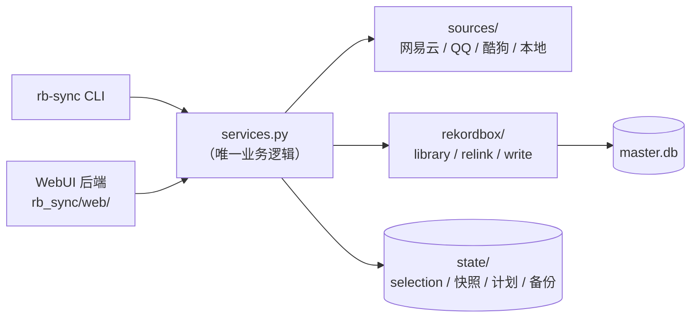

# WebUI 设计（计划）

> 状态：**W1（只读界面）已实现**，代码在 `rb_sync/web/`；W2（写入）仍为设计阶段。
> 本文同时是设计与契约文档。

## 1. 目标与非目标

**目标**

1. 一条命令起本地服务：`python -m rb_sync serve`，浏览器打开即用。
2. 让**不碰命令行**也能完成整个周期：选歌单 → 看变更 → 看库 → 重定位 → dry-run → 写入。
3. 允许用户**手动指定曲库目录**与**数据库位置**（盘符会变，不能写死）。
4. 所有会写库的操作，必须在界面上先看到 diff、再二次确认、再自动备份。

**非目标**

- 不做多用户、不做账号体系、不做公网部署。
- 不做 Electron 桌面壳（浏览器够用，壳只会增加打包负担）。
- 不因为有了 UI 就把 CLI 降级 —— **CLI 永远是完整功能**，Web 只是另一个前端。

## 2. 技术选型：零依赖 stdlib

| 方案 | 代价 | 结论 |
|---|---|---|
| `http.server.ThreadingHTTPServer` + 原生 HTML/JS | 手写约 250 行路由；没有热重载 | ✅ **推荐** |
| FastAPI + React/Vite | 引入 Node + 构建链，`pip install` 之后还要 `pnpm build` | ❌ 与"装完就能用"冲突 |
| Electron | 几百 MB 运行时 | ❌ 过度 |

现在的项目定位是「`plan` 零第三方依赖、`pyrekordbox` 可选」。为 UI 引入 npm 构建链，会让第一次使用的门槛从「装 Python」变成「装 Python + Node + 包管理器」，不划算。

保留 REST 契约，将来真需要换前端（比如加图表库），后端不用改。

## 3. 架构：先抽服务层

**这是前置重构**：目前 `plan` / `doctor` / `relink` 的业务逻辑都在 `cli/main.py`（349 行）里，Web 直接调 CLI 函数会把参数解析和业务逻辑绑死。所以先把逻辑抽到 `rb_sync/services.py`，CLI 与 Web 都变成薄壳：



好处：写库逻辑只有一份，不会出现"CLI 修了 bug、Web 没跟上"。

### 新增文件

```
rb_sync/
├── services.py           # 从 cli/main.py 抽出的业务函数（新增）
├── config.py             # 扩展：结构化配置 + 读写（改造）
└── web/
    ├── __init__.py
    ├── server.py         # 路由、静态文件、Host/Token 校验
    ├── api.py            # 各 endpoint，返回 JSON
    ├── jobs.py           # 长任务（plan/relink/write）的线程池 + 进度
    └── static/
        ├── index.html
        ├── app.js
        └── style.css
```

## 4. 配置模型（用户手动指定路径）

`config.local.json`（已在 `.gitignore` 里）：

```json
{
  "rekordbox": {
    "db_path": "F:\\PIONEER\\Master\\master.db",
    "music_roots": ["F:\\Music", "E:\\Music"]
  },
  "paths": {
    "previous_roots": ["E:/Music"]
  },
  "netease_cookie": "",
  "web": { "host": "127.0.0.1", "port": 8765 }
}
```

字段说明：

| 字段 | 用途 | 缺省行为 |
|---|---|---|
| `rekordbox.db_path` | 目标库 | 回落 `%APPDATA%\Pioneer\rekordbox\master.db` |
| `rekordbox.music_roots` | 曲目匹配与 relink 搜索目录 | 空 → UI 提示必须先设置 |
| `paths.previous_roots` | 库里出现过的旧根，relink 时自动填充 `--from` | 空 → 由 `doctor` 的缺失分布推断候选 |
| `web.host` / `web.port` | 监听地址 | `127.0.0.1:8765` |

**关键交互**：设置页有「探测」按钮，选完路径立刻返回

```
✔ 库可打开    1,231 首 / 46 个歌单 / integrity_check: ok / usn 46498
✔ 曲库目录    F:\Music 下找到 843 个音频文件，与库中 843 首对得上
⚠ Rekordbox 正在运行 —— 读取不受影响，写入会被拒绝
```

路径校验不通过时给具体原因（文件不存在 / 不是 SQLCipher 库 / 被占用），**绝不猜**。

## 5. API 契约

全部 JSON，前缀 `/api`。

| 方法 | 路径 | 作用 | 风险 |
|---|---|---|---|
| GET | `/api/settings` | 读配置（Cookie 脱敏为 `MUSIC_U=***`） | 只读 |
| PUT | `/api/settings` | 写 `db_path` / `music_roots` | 只写配置文件 |
| POST | `/api/settings/probe` | 校验路径并返回库概况 | 只读（副本） |
| GET | `/api/library` | doctor 报告：曲目、歌单树、缺失分布 | 只读（副本） |
| POST | `/api/plan` | 提交歌单链接 → 读歌单 + 变更集 | 只写 `state/` |
| GET | `/api/selection` | 当前选择配置 | 只读 |
| POST | `/api/relink/preview` | 生成重定位映射 | 只读 |
| POST | `/api/fetch/plan` | 算缺口 + 写清单（不下载） | 只写 `state/` |
| POST | `/api/fetch/run-playlists` | 整歌单下载 → 挑缺的入库 → 清空暂存区 | **执行外部命令 + 写曲库** |
| POST | `/api/relink/apply` | 回写 `FolderPath` | **写库** |
| POST | `/api/write/preview` | 生成写入计划（dry-run） | 只读 |
| POST | `/api/write/apply` | 建 playlist / 加曲目 | **写库** |
| GET | `/api/jobs/{id}` | 任务进度与结果 | 只读 |
| GET | `/api/backups` | 备份列表与还原入口 | 只读 |

约定：

- 可能超过 2 秒的操作（`plan` 拉网络、`relink` 扫目录、`apply` 写库）统一走 **job**：POST 返回 `{job_id}`，前端轮询 `/api/jobs/{id}`。
- 写操作额外要求请求头 `X-RB-Token` + body 里 `confirm: "WRITE"`。
- 错误统一 `{error: {code, message, hint}}`，`hint` 直接给用户看的下一步。

### `POST /api/fetch/run-playlists`（0.7.0）

整歌单模式，一次跑完「下载 → 挑出真缺的入库 → 清空暂存区」：

```json
{ "confirm": true, "inbox": "F:\\yun_inbox", "dest": "F:\\Music\\Sync" }
```

- **必须** `confirm: true`，否则 400 `confirm_required`。它真的会执行外部命令并写文件。
- 命令来自 `fetch.playlist_command`，**项目不含任何下载实现**。
- 返回 `{job_id}`，结果结构：
  `{inbox, dest, before, after, playlists[], moved[], failed[], cleared, kept[], state_sync}`。
- 只下载「还有缺口」的歌单；下载完只搬「确实缺的」；同名已在库不覆盖；
  清理时保留名字带 `cookie` 的 `.txt`。

## 6. 六个页面

| 页面 | 内容 | 对应流程图步骤 |
|---|---|---|
| **设置** | 库路径、曲库目录、Cookie、探测结果 | ① 前置 |
| **歌单** | 粘贴链接 / 历史歌单 → 读取 → 勾选 → 生成选择配置 | ② 读歌单 |
| **变更预览** | 每个歌单的新增 / 移除 / 重排 / 改名，逐条可展开 | ② 读歌单 |
| **库体检** | 1,231 首、46 歌单、缺失 338 的分布、缺失清单可搜索 | ⑦ 前置 |
| **重定位** | 映射表（旧 → 新 + 策略），可逐条取消；默认全选「根重映射」，「换扩展名」默认**不勾** | 维护支线 |
| **写入** | dry-run 计划 → 勾选确认 → 执行 → 报告（备份路径、耗时、校验结果） | ⑧⑨ |

写入页的确认区是硬性的三道：

1. 必须先把 dry-run 结果渲染出来；
2. 手动勾选「我已确认这份计划」；
3. 后端再校验 `is_rekordbox_running() == False`，否则直接拒绝并说明原因。

## 7. 安全设计（必须做，不是可选项）

| 风险 | 措施 |
|---|---|
| 被局域网内其它机器访问 | 默认只绑 `127.0.0.1`，不提供"开放局域网"开关 |
| DNS rebinding 绕过同源 | 校验 `Host` 头必须是 `127.0.0.1:port` / `localhost:port` |
| 别的网页偷偷 POST | 启动时生成随机 token，注入页面；写操作校验 `X-RB-Token` |
| CSRF | 同上（token 不在 cookie 里，第三方页面拿不到） |
| 误点写库 | dry-run 强制前置 + 勾选确认 + 二次输入 `WRITE` |
| 库被写坏 | 写前自动备份、写后 `integrity_check`、失败从备份还原 |

不做的：HTTPS（本机回环不需要）、密码登录（单人本地工具）。要在手机上用，建议自己套 SSH 隧道，而不是把服务暴露出去。

## 8. 里程碑

| 阶段 | 内容 | 价值 |
|---|---|---|
| **W1 只读** | 设置页（探测）+ 库体检 + 歌单读取 + 变更预览 + 重定位预览 | 零写库风险，可先用起来 |
| **W2 写入** | 重定位 apply + 写入 dry-run / apply，含备份与校验 | 打通完整周期 |
| **W3 打磨** | SSE 进度推送、任务历史、报告导出、深色模式 | 体验 |

W1 做完就有一个"能看能用"的界面；W2 才涉及风险操作。

**已定（2026-10-28）**：访问范围 = **仅本机**（绑定 `127.0.0.1`，不提供局域网开关）；
实现顺序 = **W1 只读界面优先**。

## 9. 验收标准

1. `pip install -e .[rekordbox]` 后 `python -m rb_sync serve` 一条命令可用，浏览器自动打开。
2. 未配置库路径时，界面明确提示"请先指定 master.db"，并给出默认位置建议 —— 不猜、不静默失败。
3. 换盘符后：设置页改 `music_roots` → 体检看到缺失 → 重定位预览 → 应用，全程点鼠标完成。
4. 任何写操作都能在界面上看到 diff，并且都有备份。
5. **CLI 功能不减少**；Web 起不来不影响 `rb-sync plan`。

## 10. 与现有决策的关系

- 不影响「写库必须关闭 Rekordbox」这条硬约束 —— UI 只是把它变成一个显眼的拦截。
- 不影响「不需要 LLM」的结论 —— 界面里没有任何模型调用。
- 不把 Web 变成硬依赖 —— `serve` 是可选子命令，核心仍是 CLI。
